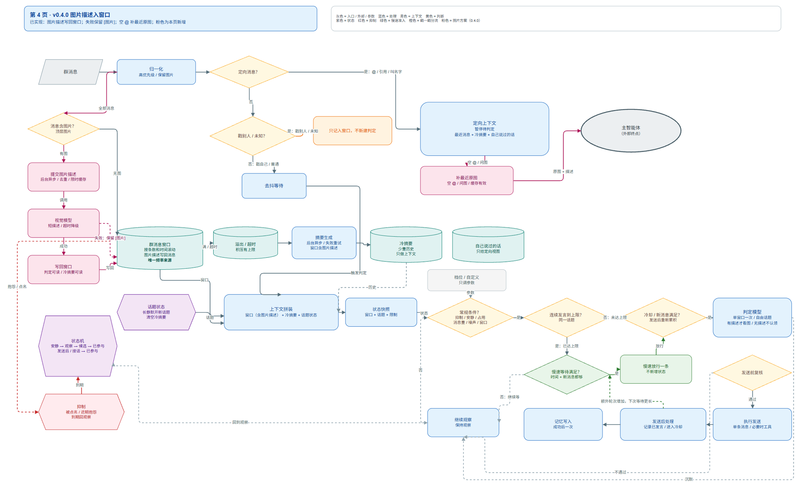

# 群聊自然插话

> AstrBot 插件：在群聊出现自然切口时，克制地接一句话，而不是每句都回。



**默认 `dry_run=true`（只判定、只写日志、不发送、不写长期记忆）**，确认效果后再切实发。

## 它解决什么

大部分"Bot 参与群聊"的实现会把状态分散在窗口、debounce、冷却、小时配额、评分阈值等多个闸门里，结果要么太吵、要么永远沉默，出了问题也很难解释。

本插件把行为收敛为：

- 一个**唯一频率窗口**（hot window），溢出只进摘要，不参与频率判定；
- 一个**Episode 状态机**：`QUIET → OBSERVING → CANDIDATE → ENGAGED`（`SUPPRESSED` 带到期时间）；
- 一条**决策契约**：`action=silent|reply`、`mode=quick|agent`、`text`、`confidence`、`continuity`；
- 默认沉默；一个窗口最多一次判定，一次判定最多一次发送，一次发送最多一次记忆写入。

## 工作方式

```text
群消息 → hot window（唯一频率来源）
        → 溢出/超时裁剪 → Summarizer → cold summaries（FIFO，最多 3 条）
        → 上下文拼装（AmbientView / DirectedView）
        → Admission（窗口/冷却/占用/消息量/定向）
        → Decider（LLM，单窗口一次）
        → 发送前复核 → Executor（quick / 只读工具）
        → 记忆写入（可选）→ 冷却 → 继续观察
```

频率不变量：

1. 一个窗口最多一次 decision；silent 后同一窗口没有新消息不再判定。
2. 发送后设置冷却，下次普通候选必须重新累积新消息并等完冷却。
3. `ENGAGED` 续聊必须有人回应或像接话，且新增消息、等完 follow-up 冷却。
4. 达到 `episode_max_turns` 后进入**慢速准入**：等待时间 + 新增消息数双条件，间隔逐次拉长（最多 30 分钟）。
5. 不写任何"每小时插话/判定次数"，也没有独立小时配额。

定向与抑制：

- 只有 @bot、引用 bot、配置的唤醒昵称算定向；**@别人只作为普通上下文**，不回复、不注入定向视图。
- 戳一戳按目标渲染（`[戳了你]` / `[戳了 @…（别人）]` / `[戳一戳（目标未知）]`）；戳别人不新建决策。
- `quiet_hours` 支持多个时段与跨零点。

## 安装

### 从插件市场安装（推荐）

AstrBot WebUI → 插件市场搜索「群聊自然插话」→ 安装 → 重载插件。

### 手动安装

```bash
cd AstrBot/data/plugins
git clone https://github.com/JackSmith111977/astrbot_plugin_group_interject_v2.git
```

然后在 WebUI 插件页重载插件（或重启 AstrBot）。

## 配置

| 配置项 | 默认值 | 说明 |
|---|---|---|
| `enable` | `true` | 总开关；关闭后不监听、不判定、不发送 |
| `mode` | `balanced` | 频率档位：`quiet` / `balanced` / `active` |
| `dry_run` | `true` | 只判定不发送、不写长期记忆；确认效果后再关闭 |
| `provider_id` | `""` | 判定 / 摘要使用的 LLM；留空跟随当前会话模型 |
| `image_caption_enable` | `true` | 是否把群聊顶层图片交给图片描述模型生成一句文本；关闭后只保留 `[图片]` 占位 |
| `memory_bridge_enable` | `true` | 是否把插话写入已安装的 LivingMemory（assistant 消息）；未安装时自动跳过 |
| `group_whitelist` | `[]` | 生效的群（群号或完整 UMO）；留空=所有群 |
| `group_blacklist` | `[]` | 不生效的群；优先于白名单 |
| `ignore_senders` | `[]` | 这些发送者的消息不进入插话窗口 |
| `wake_names` | `[]` | 唤醒昵称：消息以这些昵称开头时转交主 Agent（不需要 @） |
| `quiet_hours` | `""` | 静默时段，如 `01:00-08:00`；支持逗号分隔多段、跨零点 |
| `extra_rules` | `""` | 追加到判定 prompt 末尾的风格/禁忌要求 |
| `custom` | `{}` | 自定义频率覆盖（见下） |

`custom` 开启后可覆盖 10 个核心参数（未列出的内部时序仍沿用当前档位）：

| 子字段 | 默认 | 含义 |
|---|---|---|
| `enabled` | `false` | 启用自定义覆盖 |
| `window_size` | `40` | 热窗口消息数 |
| `window_minutes` | `15` | 热窗口时间跨度（分钟） |
| `min_messages` | `3` | 触发候选所需新消息数 |
| `cooldown_seconds` | `420` | 发送后冷却（秒） |
| `judge_cooldown_seconds` | `60` | silent 后再次判定间隔（秒） |
| `min_confidence` | `0.55` | 最低置信度 |
| `episode_max_turns` | `3` | 同一话题内最多插话轮次 |
| `episode_rest_seconds` | `900` | 慢速准入起始等待（秒） |
| `episode_reentry_messages` | `25` | 慢速重新准入所需新增消息数 |

## 控制台

WebUI → 插件详情页 →「插话控制台」：

- **热保存**：修改后保存立即生效，不需要重启；
- **Episode 监控**：每个群的 hot/cold 上下文、pending spill、摘要状态、冷却、慢速准入剩余时间、最近判定记录；
- **只读试判**：对指定群立即跑一次 Admission，返回判定结果，不发送消息。

## 只读工具与图片描述

- **工具**：当判定结果为"需要工具"且 AstrBot 中已配置搜索类工具时，插件最多执行 3 步、单步 20 秒超时；只允许 `web_search` / `websearch` / `tavily` / `exa` / `firecrawl` 前缀的**只读**工具，其他工具一律不暴露。
- **图片描述**：只处理消息顶层的 `Image`（每条最多 2 张），后台异步、去重、30 分钟缓存、失败熔断；描述写入 hot window，判定、摘要与定向视图显示为 `[图片: …]`；失败保留 `[图片]`，不阻塞消息。
- 关闭 `image_caption_enable` 后不再产生任何图片模型调用。

## 隐私与数据

- **模型调用**：判定、摘要、图片描述都会调用你在 AstrBot 中配置的 LLM Provider（与主对话使用同一套配置）。开启 `image_caption_enable` 时，群聊顶层图片会被缩放后发送给该 Provider；关闭后不发送。
- **长期记忆**：开启 `memory_bridge_enable` 且已安装 LivingMemory 时，插件把自己的插话以 `assistant` 消息写入其会话存储（不写摘要、不改写群友消息）；未安装或关闭时完全不写。
- **不引入第三方网络库**（无 aiohttp/httpx/requests），网络能力全部走 AstrBot 既有接口。
- **不读写 AstrBot 数据库**：不直接操作 `db_helper` / `data_v4.db`，不篡改会话历史。
- **文件写入**：仅在图片描述时生成临时 JPEG 到 `data/plugin_data/<插件名>/tmp/`，用后立即删除。
- **遥测**：仅保存在进程内存（计数、耗时、群号、UMO），不落盘、不外发、不记录消息正文。

## 兼容性与限制

- AstrBot `>=4.24,<5`；完整能力面向 OneBot v11（`aiocqhttp` 适配器）。
- 需要 Pillow（AstrBot 核心已内置；`requirements.txt` 仅为独立安装场景声明）。
- 主 Agent 没有"定时主动发言"的公共 API，本插件用 `context.tool_loop_agent` + 只读工具子集实现工具型回复；不支持工具时自动退回纯文本或 silent。
- 图片描述只覆盖消息顶层图片；合并转发、引用里的图片仍只有 `[图片]` 占位。

## 常见问题

**Q：装了但一直不插话？**
默认 `dry_run=true`，且默认沉默。先看控制台的判定记录；确认后用 `dry_run=false` 切实发。

**Q：怎么控制频率？**
先用 `mode` 档位（quiet/balanced/active）；需要更细粒度时打开 `custom` 覆盖 10 个参数。没有小时配额，频率由窗口、冷却、Episode 与慢速准入共同决定。

**Q：@别人为什么也回复？**
不会。@别人只作为普通上下文；只有 @bot、引用 bot、唤醒昵称会进入定向处理。

**Q：图片描述会把图片发到哪里？**
发给你在 AstrBot 中配置的 LLM Provider；可在配置里关闭 `image_caption_enable`。

**Q：会写别的插件的数据吗？**
只会在 `memory_bridge_enable=true` 且安装了 LivingMemory 时，把自己的插话以 assistant 消息写入其会话存储；关闭该开关后不写任何外部存储。

## 更新日志

见 [CHANGELOG.md](CHANGELOG.md)。

## 许可证

[MIT](LICENSE) © 2026 Kei

## 致谢

- [AstrBot](https://github.com/AstrBotDevs/AstrBot)：插件框架、Provider 与 WebUI 能力。
- Episode 状态机与频率不变量的设计来自本仓库的落地文档与线上灰度验证。
